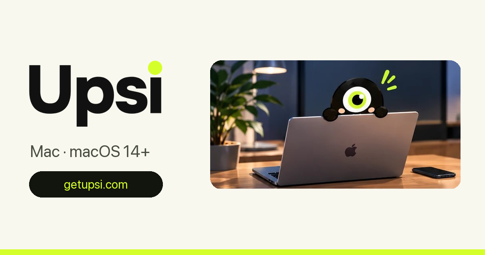

  

  <a href="README.md">English</a> · <b>Русский</b>

# Upsi: сигнализация для Mac с фото при неверном пароле

Upsi это сигнализация, которую ты ставишь на свой Mac. Когда кто-то будит заблокированный Mac (открывает крышку или нажимает клавишу) или вводит неверный пароль, Upsi делает фото камерой Mac. Фото остаётся на твоём Mac. Если хочешь, Upsi ещё и присылает его тебе в Telegram, со временем.

**[Скачать последнюю версию](https://github.com/upsi-app/upsi/releases/latest)** · [getupsi.com/ru](https://getupsi.com/ru/)

30 дней бесплатно, все функции. Потом 4,99 € в год. Для пробного периода не нужны ни аккаунт, ни карта.

## Как это работает

1. **Устанавливаешь приложение.** Перетаскиваешь его в «Программы» и открываешь. macOS просит разрешение на камеру, и в строке меню появляется глаз Upsi.
2. **Подключаешь Telegram (по желанию).** Если хочешь получать оповещения на телефон, создаёшь своего бота в Telegram, и Upsi присылает оповещения туда. Приложение показывает каждый шаг, с картинками.
3. **Занимаешься своими делами.** Блокируешь экран и уходишь. Если кто-то разбудит заблокированный Mac, ты получишь оповещение.

## Что ты получаешь

- **Фото**, сделанное в момент, когда кто-то разбудил заблокированный экран или ввёл неверный пароль. Сколько фото делать на одно оповещение, выбираешь сам.
- **Время**, всегда. **Место**, только если ты включил геолокацию, со ссылкой на карту.
- **USB-флешка (бета).** Если кто-то вставит флешку, пока Mac заблокирован, Upsi тоже сделает фото.
- **Взгляд через плечо (бета).** Когда работаешь в кафе или в поезде, глаз в строке меню становится красным, если кто-то сзади смотрит на твой экран. По желанию экран размывается, пока человек не уйдёт. Для этого Upsi ничего не сохраняет и никуда не отправляет.
- **Режим зеркала.** Маленькое окно с картинкой с камеры, как зеркало, чтобы видеть, кто сзади, не оборачиваясь.

## Видно всегда

Индикатор камеры загорается при каждом фото. Глаз Upsi всегда в строке меню, и спрятать его в приложении нельзя. При первой разблокировке после установки, а потом не чаще раза в 7 дней, появляется сообщение «Upsi работает на этом Mac», и выключить его нельзя.

Upsi предназначен только для Mac, который принадлежит тебе. Условия запрещают использовать его для наблюдения за другим человеком. Если ты думаешь, что кто-то поставил Upsi без твоего согласия на компьютер, которым ты пользуешься, напиши на contact@getupsi.com.

## Твои данные

- **Где фото?** На твоём Mac, в папке «Изображения › Upsi». Папку можно поменять в настройках. Фото удаляются сами через выбранное число дней (по умолчанию 30).
- **Кто ещё их видит?** Только ты. Если ты подключил своего бота в Telegram, фото уходят ещё и в чат с твоим ботом. Они проходят через серверы Telegram, как любое сообщение (чаты с ботами не защищены сквозным шифрованием), но никогда через наши. Сервера, который их принимает, у нас нет.
- **Что получаем мы?** Только ключ лицензии, когда Upsi проверяет, что он действителен, и вопрос, вышла ли новая версия.

## Сколько стоит

4,99 € в год за один Mac, после 30 бесплатных дней. Пока оплата идёт криптой через [@CryptoBot](https://t.me/CryptoBot) в Telegram (USDT, TON, BTC и другие), оплата картой скоро вернётся. В Upsi нажми «Оплатить криптой» в Настройках › Лицензия, и откроется пошаговая инструкция. Оплата действует год и сама не продлевается.

## Требования

- macOS 14, 15 или 26, Apple silicon или Intel
- 5,5 МБ
- Подписано Developer ID и нотаризовано Apple, поэтому открывается без предупреждений

## Об этом репозитории

Здесь лежат официальные версии Upsi и открытое место для вопросов и сообщений об ошибках. Исходный код приложения здесь не публикуется.

- **Нашёл ошибку или есть идея?** [Создай issue](https://github.com/upsi-app/upsi/issues/new) или напиши на contact@getupsi.com.
- **Условия и конфиденциальность:** [getupsi.com/ru/terms](https://getupsi.com/ru/terms) · [getupsi.com/ru/privacy](https://getupsi.com/ru/privacy)

© 2026 Upsi. Все права защищены.
